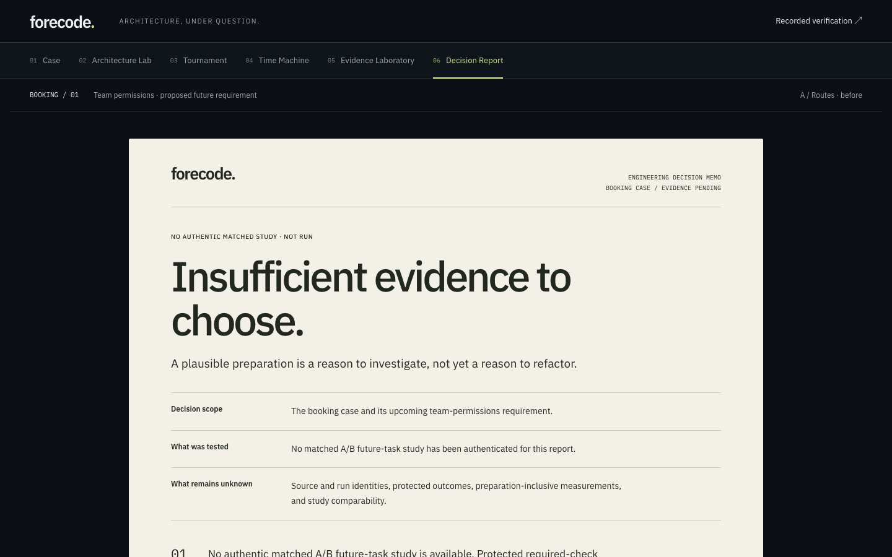

# ForeCode independent judge-readiness audit — November 1, 2026

**Decision: GO for an honest local no-evidence rehearsal; NO-GO for submission sign-off or a claimed measured A/B benefit.** Software checks pass with legitimate local socket permissions. The current public catalogs contain no approved study, recorded verification or certificate. Schema-valid long identifiers break the mobile memo, and an unbroken source filename overflows the preparation list. Public deployment/video access and final owner eligibility declarations were not supplied and remain unverified.

This is a source and software-behavior audit, not an experimental result, security attestation or organizer eligibility decision. No new inference, coding-agent execution, protected experiment, signer, runtime admission, disclosure, deployment or merge occurred.

## Scope and source

- Audited freshly fetched `origin/main`: `efc6fc6b7bf254be3ac4550e558ec107c7d4984f`, PR #58's merge. Isolated branch: `codex/judge-readiness-audit`; worktree: `ForeCode-Judge-QA`.
- Read `AGENTS.md`, the v6.4 implementation report, November 1 E2E validation, replay/frontend integration and Decision Report design. Read the external planning acceptance, judge gates, submission checklist and October 26 participant-rule summary. Planning files were not copied into this entry; contract pin remains `695e68a40b5f5009c9b06b83a1181e18cd6d0223`.
- Inspected merged PRs [#54](https://github.com/matthiasdruhl/ForeCode/pull/54), [#56](https://github.com/matthiasdruhl/ForeCode/pull/56), [#57](https://github.com/matthiasdruhl/ForeCode/pull/57), [#58](https://github.com/matthiasdruhl/ForeCode/pull/58). Inspected current open PRs #27–30 and their file lists before finalizing ownership. QA's new files do not overlap their test files or Agent 2's frontend/shared tests. Only a small required implementation-log entry touches an existing document.
- Browser preview used the production build with provider keys absent, `META_CALLS_ENABLED=false`, `META_SPENDING_APPROVED=false`, and the existing external-fetch blocker. Existing E2E uses its reviewed synthetic keys and blocker. Node `v24.16.0`; Chromium supplied by locked Playwright `1.64.1`.
- Fresh first-visitor walkthrough completed Case → Architecture Lab → Tournament → Time Machine → Evidence Laboratory → Decision Report. Production screens captured at 1440, 768 and 390px. In-app browser inspection supplemented Playwright. Automated accessibility: temporary `axe-core@4.11.0`, 18 chapter/viewport scans plus mobile `/experiments` and `/certificates`. [Sanitized observed scan results](qa/judge-readiness-20261101/accessibility-scan.json).

## Prioritized findings

### R0 — P0 readiness gate: public evidence chapter cannot demonstrate an actual result

- **Reproduce:** start the production app; open `/#tournament`; expand full publication; open `/#time` and expand five-stage replay; visit `/#evidence`, `/#report`, `/experiments`, `/certificates`, and `GET /api/demo`.
- **Route/component:** production [catalog](../src/server/artifacts/recording-catalog.ts), [publication registration](../src/server/artifacts/approved-tournament-publication.ts), six-chapter experience and catalogs.
- **Observed:** NOT RUN, no approved study, five Unknown stages, an inconclusive memo, empty recording/certificate catalogs, and empty demo arrays. Production registration is `createTournamentPublicationReader(null)`. This is correct fail-closed behavior, not a new verdict bug.
- **Expected for judge sign-off:** an accessible genuine result with source/run/receipt/check scope if the demo claims one. Otherwise explicitly adjudicate the honest insufficient-evidence fallback. A local template does not establish qualifying Meta inference, architecture benefit or protected success.
- **Minimal action:** evidence/disclosure owners complete their existing independent approval and exact-publication process; frontend owner binds only approved data. Do not add sample results, relax source admission or promote historical Meta text into a new study. If approval is unavailable, retain the honest fallback and remove any measured-benefit claim.
- **Relevant checks:** `tournament.spec.ts`, `replay.spec.ts`, `recorded-verification.spec.ts`, `recorded-certificates.spec.ts`, `decision-report.test.ts`, new `judge-evidence-readiness.test.tsx`.
- **Blocks submission:** blocks sign-off on the planned evidence-backed demonstration and any measured-benefit claim. Absence of an A/B pair alone is not asserted here to be organizer disqualification; qualifying Meta use and remaining submission requirements need their own evidence.

### QA-01 — P1: the working booking action has no entry from the Case

- **Reproduce:** open `/` in a clean browser; read “Find a room. Make a booking”; activate “Explore the booking case”; inspect available links through the six chapters.
- **Route/component:** Case in [research-experience.tsx](../src/components/v6/research-experience.tsx); standalone [booking fixture](../fixtures/booking-v1/README.md).
- **Observed:** the primary action opens Architecture Lab. No visible link opens the standalone booking app. The independently served fixture works in its two browser tests, but a judge cannot discover it from the product. The opening is descriptive rather than a demonstrable booking action.
- **Expected:** the demo acceptance's present-day booking action is reachable with clear separation from the future team-permissions proposal.
- **Minimal fix for separate review:** expose the separately hosted, reviewed fixture through an explicitly labeled link once its approved public URL exists; retain its separate deployment and synthetic fixed-viewer disclosure. A prepared rehearsal tab is a temporary presentation workaround, not a repaired product entry.
- **Relevant check:** existing `tests/fixture-e2e/booking.spec.ts` proves reviewed fixture behavior; manual Case-link inventory reproduces the discoverability gap. Add a link/access smoke once the real approved URL is available.
- **Blocks submission:** blocks self-guided completion of the planned present-day booking story; does not prevent the no-evidence local walkthrough.

### QA-02 — P1: valid long study/task identifiers overflow the mobile memo

- **Reproduce:** run the QA-owned Playwright test named `QA-02`. It renders the reviewed test-only tournament with a 128-character study ID, a 128-character task ID and valid source/receipt bindings, using both actual stylesheets. Set viewport to 390px.
- **Route/component:** Decision Report [memo](../src/components/v6/decision-memo.tsx); `.memo-state` and `.memo-facts dd` in [v6 CSS](../src/app/forecode-v6.css).
- **Observed:** the 390px document expands to **684px**. Unbroken study/task text leaves the paper and becomes dark text against the dark workbench. Standard short-ID screenshots pass. At 1440/768px the same probe did not overflow. The 64-character hashes and 128-character run/receipt IDs in Source History and Evidence Detail wrap correctly at all three widths. Hyphenated paths wrapped in the initial probe; the stronger unbroken-filename counterexample is QA-07.
- **Expected:** complete identifiers remain readable inside the paper with no page-level horizontal scrolling or truncation.
- **Suggested minimal patch, not applied:**

  ```css
  .memo-state,
  .memo-facts dd {
    overflow-wrap: anywhere;
  }
  ```

  A disposable synthetic browser document with only that proposed CSS changed from 684px to 390px scroll width. Production source remains unchanged. Recheck memo states, full evidence identifiers and print after frontend-owner review. Keep identifiers intact; do not shorten or hide them to pass the check.

- **Relevant check:** `tests/e2e/judge-readiness.spec.ts`, `QA-02`; screenshot `QA-02-synthetic-long-identifiers.png` is generated in ignored test output and is explicitly synthetic QA data.
- **Blocks submission:** blocks a responsive-readiness pass for legal publication identifiers. The current empty catalog does not exercise it.

### QA-07 — P1: preparation file paths can overflow at every required width

- **Reproduce:** run the QA-owned `QA-07` Playwright case. Its reviewed synthetic projection contains `src/` plus a 192-character unbroken filename and `.ts`. This is accepted by `PublicTournamentSchema`; the filename segment is below 255 bytes. Render Source History with B / Prepared using the real stylesheets.
- **Route/component:** Time Machine, [source-phase-inspector.tsx](../src/components/v6/source-phase-inspector.tsx), `.source-file-list code` in the v6 stylesheet.
- **Observed:** document widths are **1720px at 1440**, **1696px at 768**, and **1692px at 390**. The source path has no wrap rule, even though adjacent hash spans do. The existing hyphenated-path probe did not expose this.
- **Expected:** complete schema-valid source paths wrap inside the preparation file comparison; no page-level horizontal scroll or clipping.
- **Minimal fix for separate review:** `.source-file-list code { overflow-wrap: anywhere; }`. In a disposable synthetic browser document that one rule reduced scroll width to exactly 1440/768/390. Production source remains unchanged.
- **Relevant check:** new `QA-07: preparation source paths wrap unbroken filenames`; generated JSON attachment records all three observed widths and the generated screenshot is test-only synthetic data.
- **Blocks submission:** blocks a populated-source responsive-readiness pass. Current empty catalogs do not exercise the path list.

### QA-03 — P2: comparison scroller lacks an explicit accessible region/focus contract

- **Reproduce:** open `/experiments` at 390px. The empty comparison's viewport is 314px and content is 437px. Inspect `.comparison-table-scroll`: no `tabindex`, role or accessible label. Run axe's `scrollable-region-focusable` rule, then actually Tab to the scroller and press ArrowRight.
- **Route/component:** empty walkthrough in [tournament-overview.tsx](../src/components/tournament-overview.tsx).
- **Observed:** axe flags a serious scanner violation. **Actual audited Chromium does reach the DIV on Tab and scrolls with ArrowRight**, through the browser's automatic scroll-container focus behavior. No Chromium keyboard failure is claimed; WebKit/Firefox were not tested.
- **Expected:** an explicit, named, discoverable keyboard scroll region consistently across supported browsers.
- **Minimal fix for separate review:** `tabIndex={0}`, `role="region"` and an `aria-label` describing the table, using the established Measurement Rail pattern; retain the semantic table/caption and focus outline.
- **Relevant check:** new `QA: Chromium keyboard users can reach and scroll the recorded comparison table` passes; sanitized scan retains the warning and its adjudication.
- **Blocks submission:** no confirmed Chromium blocker; portability and assistive-technology follow-up required.

### QA-04 — P2: inactive chapter numbers fail normal-text contrast

- **Reproduce:** open any chapter; inspect an inactive chapter's small `01`–`06` text. Run the QA contrast reproduction or axe color-contrast rule.
- **Route/component:** `.chapter-rail a span` in [v6 CSS](../src/app/forecode-v6.css).
- **Observed:** 10px text with opacity 0.7 yields foreground approximately `#757982` against `#10151c`, **4.2:1**, below 4.5:1. Labels remain readable; the defect is the smaller number text. Repeated across all three widths; off-screen items are separately incomplete in scanner output.
- **Expected:** normal text contrast at least 4.5:1 without relying on the adjacent readable label.
- **Minimal fix for separate review:** remove/reduce the number opacity or choose a brighter token, then verify actual composited contrast and active-state distinction. No palette-wide change is necessary.
- **Relevant check:** new `QA-04: inactive chapter numbers meet normal-text contrast`, plus axe scan.
- **Blocks submission:** does not block the journey; prevents an unqualified accessibility-conformance claim.

### QA-05 — P2: chapter context and Atlas landmark structure need refinement

- **Reproduce:** inspect landmarks on Case/Lab and run axe best-practice rules. Compare with Tournament's main landmark.
- **Route/component:** `.research-body`/`.case-context` in [research-experience.tsx](../src/components/v6/research-experience.tsx); `.atlas-inspector` in [architecture-atlas.tsx](../src/components/architecture-atlas.tsx).
- **Observed:** chapter context, mobile scroll hint and Case/Lab chapter heading sit outside the content main; the embedded workspace owns the Case/Lab main. The Atlas complementary `aside` is nested within that main. Scanner reports `region` and `landmark-complementary-is-top-level`. These are best-practice findings, not proof of screen-reader failure.
- **Expected:** consistent landmark navigation encompasses the chapter introduction, context and content; inspector has suitable local section semantics.
- **Minimal fix for separate review:** let the outer chapter own the sole content main, make the embedded workspace non-main in this context, and consider a labeled section for the local inspector. Preserve standalone workspace semantics and the tested skip target.
- **Relevant check:** sanitized axe scan; existing skip/focus browser tests must remain passing. Follow with actual VoiceOver landmark/headings navigation.
- **Blocks submission:** no demonstrated journey failure; manual assistive-technology sign-off remains open.

### QA-06 — P2: locked development tooling has a moderate advisory chain

- **Reproduce:** clean locked install, then `npm audit --json` at audited source.
- **Route/component:** existing npm development dependency tree; no dependency changes made.
- **Observed:** audit exits 1 with 15 moderate affected-package entries, zero high/critical. Entries trace to the development ESLint/minimatch chain, including [GHSA-g3hv-75wg-m249](https://github.com/advisories/GHSA-g3hv-75wg-m249). This is not 15 independent vulnerabilities or demonstrated public-app exploitation. Install also reports existing ESLint peer-range warnings.
- **Expected:** reviewed toolchain advisory disposition and a supported compatibility upgrade when available.
- **Minimal fix for separate review:** dependency owner assesses compatible locked tooling updates and reruns lint/build/tests. Audit offers major/downgrade suggestions; do not blindly run `npm audit fix --force` before freeze.
- **Relevant check:** npm audit against the unchanged lockfile; full check passes despite the advisory/peer warnings.
- **Blocks submission:** no observed production-runtime exploit or build failure; tracked development-tooling follow-up.

## Actual current report



## Judge journey assessment

| Question                             | Observed result                                                                                                                                                   |
| ------------------------------------ | ----------------------------------------------------------------------------------------------------------------------------------------------------------------- |
| Purpose identifiable quickly?        | Yes by editorial assessment: first-screen copy describes booking → team permissions → whether preparation is worthwhile. No timed naive-user study was performed. |
| Current behavior versus future work? | Clear TODAY/NEXT labels, fixed demo viewer/in-memory constraints and conceptual trace labels. Actual booking action discoverability is QA-01.                     |
| Meta reasoning versus grading?       | Proposal/template provenance, consent, falsifiable hypothesis and counterexample are separate from protected checks. Template flow dispatches no model request.   |
| Alternatives understandable?         | A/Keep and B/Prepare stay balanced; B preparation counted. Diagram is conceptual; Atlas is bounded reviewed source.                                               |
| Meaningful evidence inspection?      | Missingness and exact inspection questions work, with exact trigger focus restored. Current production cannot show a genuine populated ledger (R0).               |
| Report justified?                    | Current report abstains. Synthetic A-only/B-only results retain scoped recommendations; both-pass remains an inconclusive correctness tie.                        |
| Missing evidence visibly missing?    | Yes: missing receipts, source snapshots, metrics, chronology and model lineage are not repaired by invented results.                                              |

## Evidence-integrity coverage

All negative-case inputs are existing reviewed synthetic fixtures in disposable test-owned directories or isolated component documents. A passing software test confers no production evidence authority.

| Case                                    | Observed invariant and regression source                                                                                                                                                                    |
| --------------------------------------- | ----------------------------------------------------------------------------------------------------------------------------------------------------------------------------------------------------------- |
| No publication                          | Production empty catalogs; five missing replay stages and inconclusive memo. `tournament.spec.ts`, `replay.spec.ts`, `decision-report.test.ts`.                                                             |
| Unavailable publication                 | Unavailable composer excludes report; no stale success. `replay-presentation.test.tsx`, new QA withdrawal suite.                                                                                            |
| Expired/revoked evidence                | Fresh loader returns unavailable, and visible favorable memo disappears. QA withdrawal suite tests both torn-read directions, plus existing `decision-report.test.ts` and `tournament-publication.test.ts`. |
| Missing original/tampered publication   | Same withdrawal through actual loaders → join → rendered memo; QA suite's four cases pass.                                                                                                                  |
| Mismatched study/projection/run/receipt | Exact identity joins reject changed/absent/malformed projection and signed-original mismatch. `replay-presentation.test.tsx`, `decision-report.test.ts`, `replay-evidence-links.test.ts`.                   |
| Missing required receipt                | Insufficient/unavailable, never fabricated pass or rejection. `decision-report.test.ts`, `tournament-publication.test.ts`.                                                                                  |
| Incomparable conditions                 | INCONCLUSIVE; fairness blockers remain inspectable. `decision-report.test.ts`, `frontend-v6.test.tsx`.                                                                                                      |
| Both verified                           | Correctness tie; complete telemetry does not invent a prospective effort criterion. Same suites and six-outcome browser rendering.                                                                          |
| A-only / B-only verified                | Scoped KEEP / review preparation from authoritative server report, with exact checks and matching projection. Same suites.                                                                                  |
| Both rejected                           | INCONCLUSIVE; failed checks retained. Same suites.                                                                                                                                                          |
| Missing metrics / legitimate zero       | Unknown remains Unknown; recorded zero remains zero; reservation is not spending. `decision-report.test.ts`, `frontend-v6.test.tsx`, `tournament.spec.ts`, `recorded-certificates.spec.ts`.                 |

Source review confirms that `Home` loads server catalogs and uses `composeReplayPresentation`; the client memo consumes that report and its copy adapter does not call `assessDecisionReport`. `meta-interpretation.test.ts` rejects model-added verdict/authority fields and client-authored evidence; its browser suite fails closed for unissued IDs. Production imports no test fixtures (`web-boundary.test.ts`). Preparation/downstream totals remain distinct, modeled worksheet points are labeled assumptions, and both Tournament and memo explicitly require a separate equally informed non-Meta control before claiming Meta incremental benefit.

Freshness is established on a trusted load. An already-open browser document is a historical view; no continuous revocation push or independently verified exported snapshot is claimed. Reload before final current-evidence assertions.

## Release and accessibility results

| Validation                                                       | Observed result                                                                                                                                                                                                                                                     |
| ---------------------------------------------------------------- | ------------------------------------------------------------------------------------------------------------------------------------------------------------------------------------------------------------------------------------------------------------------- |
| Locked `npm ci --ignore-scripts`                                 | Exit 0; Node 24, no lockfile change. Existing peer warnings and moderate advisory chain retained.                                                                                                                                                                   |
| Initial restricted `npm run check`                               | Exit 1: lint/typechecks passed; 1,612 tests passed and 2 failed because existing Python controls could not bind Unix sockets (`PermissionError: [Errno 1] Operation not permitted`); build not reached.                                                             |
| Unchanged check with approved local-socket access                | Exit 0; lint, both typechecks, 1,614 tests/72 files, both production builds. Provider keys removed and calls/spending disabled. No test/security control changed.                                                                                                   |
| `npm run build` (separate observation)                           | Exit 0; both production builds.                                                                                                                                                                                                                                     |
| Existing `npm run test:e2e`                                      | Exit 0; 78 app browser cases, synthetic credentials/external-provider blocker preserved.                                                                                                                                                                            |
| `npm run test:fixture-e2e`                                       | Exit 0; 2 reviewed booking browser cases.                                                                                                                                                                                                                           |
| `PLAN_REFERENCE_ROOT=../AgentHarness-Planning npm run test:plan` | Exit 0; 128 checks against immutable SPEC-LOCK reference, not current planning HEAD.                                                                                                                                                                                |
| New QA unit suite                                                | Exit 0; 4 fresh withdrawal cases through actual synthetic protected loaders and visible memo.                                                                                                                                                                       |
| New QA browser suite                                             | Exit 0; 8 ordinary passing cases and **6 expected failures** (QA-02, QA-04 and QA-07 in each project). Playwright's list reporter calls all 14 accepted outcomes “passed”; the six expected-failure instances remain open release findings.                         |
| Final `npm run check` including QA                               | Exit 0; lint, both typechecks, **1,618 tests/73 files**, both production builds. Final full app browser run: exit 0; **86 ordinary passes + 6 expected failures**, zero skipped/unexpected/flaky. See QA-02/04/07; these defects remain open.                       |
| Offline historical Meta recording verifier                       | Exit 0; internal schema/hash/chronology/source/model/token arithmetic only. No provider call or independently authenticated historical HTTPS exchange, invoice or restored issuance.                                                                                |
| Provider-absent production preview                               | All six chapters work without provider keys; disabled consent flow/local template stays labeled. No new live-call validation.                                                                                                                                       |
| 18 production chapter/viewport observations                      | No document overflow with current no-publication data; no console/page errors, unexpected HTTP errors or external requests. Long-ID/source-path counterexamples remain QA-02/07.                                                                                    |
| Routes/history/intent lifecycle                                  | Existing deep-link, Back/Forward, stale-selection, edit/revoke, exact evidence-return and clean-reload checks pass. Browser memory is intentionally cleared on reload.                                                                                              |
| Keyboard/motion/print                                            | Graph Tab order, Space/Enter, visible 2px focus, reduced-motion animation/transition suppression, native replay disclosure and report print-media limits pass. New print test confirms memo missingness/limits remain visible even when printing from Time Machine. |
| Accessibility scan                                               | Confirmed contrast defect; landmark warnings; scroll warning adjudicated with actual keyboard behavior. Incomplete/off-screen contrast is not a pass. Mobile `/certificates` has no scanner violations in this state.                                               |
| Public-boundary security                                         | Existing full boundary/tamper/interpretation suites pass. Browser preview made only local requests. No observed browser credential/private-root/protected-assertion leak. This is bounded QA, not a penetration-test certification.                                 |

Initial QA authoring caught an incorrect assertion expecting a final receipt in the Prepared source phase; corrected the test to require the actual baseline receipt. A speculative scroll expected-failure annotation produced “unexpected pass”; removed it after actual keyboard reproduction. No production code or existing assertion was changed to obtain a pass.

Not validated: deployed hosting/TLS/clean-incognito public URLs, actual live-provider availability/credits, real A/B execution, physical tablet/phone, Safari/WebKit/Firefox, manual screen reader, physical printing or tagged-PDF accessibility. Print CSS/DOM observation is not certification of an exported PDF's reading order. Human rights/eligibility/track/rubric/portal declarations remain the owner's responsibility. The planning rule summary itself notes a judging-weight discrepancy; do not repeat exact percentages as independently confirmed.

## GO / NO-GO matrix

| Gate                                                | Current decision                      | Exit criterion                                                                                                                                                                                                      |
| --------------------------------------------------- | ------------------------------------- | ------------------------------------------------------------------------------------------------------------------------------------------------------------------------------------------------------------------- |
| Local no-inference software rehearsal               | GO with disclosed UI findings         | Run commands below; retain absent-evidence story and template labels.                                                                                                                                               |
| Self-guided present-day booking story               | NO-GO for planned journey             | QA-01 approved accessible fixture entry and clean-browser booking action.                                                                                                                                           |
| Responsive populated report                         | NO-GO                                 | QA-02/07 fixed by frontend owner; remove expected-failure annotation and verify 390/768/1440 plus print.                                                                                                            |
| Accessibility sign-off                              | CONDITIONAL / incomplete              | Fix QA-04; adjudicate QA-03/05 with supported browsers and VoiceOver. Keyboard Chromium itself passes.                                                                                                              |
| Genuine measured A/B / evidence-backed winner claim | NO-GO                                 | Fresh authentic matching receipts/source/protocol, complete attempts/preparation, separate approval and exact public provisioning.                                                                                  |
| Meta qualifying-use presentation                    | NOT VERIFIED for this browser session | Owner-approved genuine live or explicitly recorded hypothesis and distinct counterexample, provider/model/date visible. Existing recording consistency alone is not independent historical provider authentication. |
| Meta superiority/generalization claim               | NO-GO                                 | Valid separate equally informed comparator and appropriate independent evidence; single-case A/B is insufficient.                                                                                                   |
| Public repository visibility                        | GO for visibility only                | GitHub metadata reports public; this does not resolve provenance/legal eligibility.                                                                                                                                 |
| Public demo/video and submission portal             | NOT VERIFIED → NO-GO sign-off         | Fresh unauthenticated access, final video/provenance/owner declarations, and portal receipt.                                                                                                                        |

## Before the November 2 feature freeze

1. Frontend owner: apply the memo wrapping fix for QA-02 and source-path wrapping fix for QA-07; recheck actual full identifiers and print. Remove their expected-failure annotations only after the desired behavior passes.
2. Release/frontend owner: make the approved standalone booking demo discoverable (QA-01); rehearse a real create/overlap/cancel action with fixed-viewer disclosure.
3. Evidence owners: adjudicate R0 using existing custody/runtime/disclosure gates. If genuine public evidence cannot be approved, freeze the honest fallback; do not manufacture a successful report.
4. Frontend owner: fix number contrast (QA-04), and add the named explicit table focus target (QA-03). Recheck keyboard order, focus and source/evidence return.
5. QA/release owner: perform manual VoiceOver, supported-browser and public clean-session checks. Resolve QA-05 semantics if needed; retain exact model/recording/measurement limitations.
6. Dependency owner: disposition QA-06 separately; avoid a blind major upgrade immediately before freeze. Release owner records accessible demo/video URLs, source provenance and organizer declarations.

## Clean-browser final rehearsal checklist

- [ ] Record release commit, deployment URL, fixture URL, actual catalog/study/projection IDs (or “none”), model recording identity/date and the person performing sign-off. Never put private custody roots/keys in this report.
- [ ] New incognito browser, no privileged login, storage or extensions. Open public repo, main app, fixture and video; check TLS/assets/console/network. Local QA does not satisfy this box.
- [ ] At 1440, 768 and 390px: read purpose, distinguish current booking from future delegation, create/overlap/cancel in the reviewed fixture, then return to ForeCode.
- [ ] Complete Case → Lab → Tournament → Time Machine → Evidence → Report. Use direct chapter links and Back/Forward. Check mobile chapter rail and locally scrollable graphs/tables.
- [ ] Use Tab/Shift+Tab only, Enter/Space, graph text inspector, disclosure controls, skip link and evidence return. Verify all focus is visible and no trap. Use VoiceOver landmarks/headings/labels; inspect reading order.
- [ ] Confirm intent, inspect exact consent payload, use separately authorized actual Meta or explicitly recorded genuine outputs. Do not spend or execute as part of this QA checklist without separate authorization. Templates stay templates.
- [ ] Edit/revoke intent; confirm old sharing approval, dependent research and obsolete selections are invalidated. Export before reload if the session matters.
- [ ] Inspect authenticated required checks, source/run/receipt IDs, complete attempts, A/B conditions and prep-inclusive accounting. If absent/stale/mismatched, report remains unavailable/inconclusive. Do not test revocation on genuine evidence; use disposable reviewed fixtures.
- [ ] Check long legal study/task IDs after QA-02/07 fixes, hashes, paths, errors, Unknown versus zero, and reduced-motion preference. Compare exported/printed memo scope, identifiers and limitations; complete print/screen-reader review.
- [ ] Check statement discipline: Meta proposes; independent evidence grades; no inferred winner for both-pass; no A/B proof of Meta superiority; no static-graph probability or invented savings.
- [ ] Video is at most three minutes, opens with accurate pre-event planning/new-event-work disclosure, and matches visible source/results. Verify contributor approval, rights, one track/theme and actual accepted rules privately.
- [ ] Submit before **November 4, 2026, 9 PM America/New_York**, retain portal confirmation, and record the final GO/NO-GO owner decision. No automatic QA merge during an active source-bound study.

## Reproduction commands

Run from the isolated application worktree with Node 24 and locked dependencies. Clear real provider credentials; retain the existing no-provider-network preload for browsers. Distinct ports prevent reuse of another worktree's server.

```sh
npm ci --ignore-scripts
META_CALLS_ENABLED=false META_SPENDING_APPROVED=false npm run check
FORECODE_E2E_PORT=3430 FORECODE_E2E_DISABLED_PORT=3432 npm run test:e2e
FORECODE_FIXTURE_E2E_PORT=3431 npm run test:fixture-e2e
PLAN_REFERENCE_ROOT=../AgentHarness-Planning npm run test:plan
npx vitest run tests/unit/judge-evidence-readiness.test.tsx
FORECODE_E2E_PORT=3440 FORECODE_E2E_DISABLED_PORT=3442 npm run test:e2e -- tests/e2e/judge-readiness.spec.ts
```

QA-owned tests/docs only; proposed production fixes remain for separate review. Do not merge automatically.
