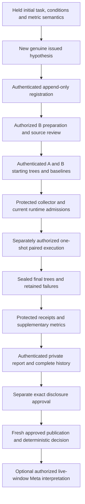

# Next prospective tournament: integration acceptance gates

Basis: `origin/main` `03f5deb2521facb58c26fd3fcf4bc6199bd8b210`, November 1, 2026 Eastern. These are **later acceptance requirements**, not claims that unmerged work passes. Agent D changed no implementation, contracts, tests, configuration or other agent's branch. [Readiness](TOURNAMENT-NEXT-STUDY-READINESS.md) records actual observations; [runbook](TOURNAMENT-NEXT-STUDY-OPERATOR-RUNBOOK.md) records the authorization-gated operating procedure.

## Canonical representations: use existing identities

| Concept                            | Actual representation at assessed source                                                                                                                                                                                                             | Required integration behavior                                                                                                                                                                                                                                       |
| ---------------------------------- | ---------------------------------------------------------------------------------------------------------------------------------------------------------------------------------------------------------------------------------------------------- | ------------------------------------------------------------------------------------------------------------------------------------------------------------------------------------------------------------------------------------------------------------------- |
| Full pre-selection definition      | `StudyDefinitionSchema`, `protocolSubject(definition) = jsonDigest(validateStudyDefinition(definition))`                                                                                                                                             | Preserve this authenticated original, including prompt/adapter/runtime inputs; do not substitute the protocol-only hash.                                                                                                                                            |
| Protocol-only commitment           | `jsonDigest(definition.protocol)`; `futureProtocolCommitment(draft)`                                                                                                                                                                                 | Equal before/after preparation. `PreparationRecordSchema.protocolSha256` uses this protocol-only identity.                                                                                                                                                          |
| Held original                      | `CustodianRecordSchema`: `id`, `studyId`, `kind`, `subjectSha256`, `predecessorSha256`, `heldAt`, `expiresAt`; envelope signature and original byte hash                                                                                             | Trust only `createStudyCustodyStore`/`requireHeldRecord` objects with externally pinned key/allowlist/revocation bytes. Existing kind enum has no new Scientist-specific kind. A/B must document the reviewed mapping rather than infer a new enum from this table. |
| Prepared commitment                | `preparedSubject(definition,draft,evidence)` and `PreparedStudy.protocol/prepared.sha256`                                                                                                                                                            | Link actual preparation/source/metrics and original envelope predecessors. A serialized copy cannot acquire the in-process marker.                                                                                                                                  |
| Hypothesis/context                 | `IssuedHypothesis` `{hypothesis, issuedAt, contextSha256}`; transport `digest(hypothesis)`; full `requestSchemas.hypothesize` context                                                                                                                | Preserve issued UUID/content and exact accepted intent/revision/graph/candidates/scenarios/goal; no text matching.                                                                                                                                                  |
| Scientist registration             | `ProspectiveRegistrationSchema`: `id`, `hypothesisId`, `hypothesisSha256`, `issuedAt`, `registeredAt`, `expiresAt`, `context`, `study`                                                                                                               | `study` is Decision Report identity without `preparedOriginalSha256`, `comparability`, `correctness`, which cannot exist prospectively. Current parser alone grants no authority.                                                                                   |
| Exact prospective `study` identity | `studyId`, `taskId`, `taskDefinitionSha256`, `definitionSha256`, `protocolOriginalSha256`, `model`, `order`, baseline/future evaluator/suite/policy hashes                                                                                           | Compare all fields with authenticated later report; do not invent duplicate identity fields or silently conflate suite and policy.                                                                                                                                  |
| Matched downstream conditions      | `ArmConditionsSchema` + `ExecutionConditionsSchema`, definition/restrictions and trial policy; `sharedFutureTask(study)`                                                                                                                             | Match after excluding only `variant`, including resources/budgets/model/tools/full task/prompt/adapter, not only a model string.                                                                                                                                    |
| Runtime admissions                 | `runtimeOriginalIds[variant].paired/installed`; `pairedRuntimeSubject`, `supervisedTeamRuntimeSubject`; `teamCompositionDigest`; `TeamInventorySchema`                                                                                               | Four distinct current originals, correct predecessors and current source/inventory/enforcement/composition/provider; no `enabled`-only bypass.                                                                                                                      |
| Protected receipt identity         | `EvaluationIdentitySchema`: `runId`, `evaluatedTreeSha256`, `fixtureSha256`, `evaluatorSha256`, `testSuiteSha256`, `requiredPolicySha256`, `requiredCheckIds`; protected entry `bundleSha256`                                                        | Original bounded bundle + exact check bytes and allowlist identity, fresh in-process `TrustedEvaluation`, distinct A/B baseline/future IDs.                                                                                                                         |
| Supplementary metric protocol      | `MetricProtocolSchema`: `studyId`, `hypothesisId`, `contextSha256`, `taskSha256`, `matchedConditionsSha256`, evaluator/suite/policy, external packages, stylesheet paths, boundary rules, authorization case IDs, window/duplicate policy/prediction | Authenticate precise digest semantics. `taskSha256` here is not automatically `ArmConditions.taskSha256` or `taskDefinitionSha256`; A/B must explicitly map which existing canonical content is hashed. Same requirement for `matchedConditionsSha256`.             |
| Metric observations                | `MetricObservationsSchema`: protocol/task/conditions/evaluator/suite/policy hashes; A/B `variant`, `runId`, status, baseline/final `treeSha256`, boundary complete/unresolved/scanned rules/edges and case outcomes                                  | Protected authenticated completeness and exact source/run bindings are required beyond schema validation. No additional invented public fields are specified here.                                                                                                  |
| Private report / history           | `loadTournamentArm`, `historySubject`, `buildMeasuredTournamentReport`; `RuntimeObservationSchema`, optional `TelemetrySchema`                                                                                                                       | Actual runtime originals, full ordered history, prep-inclusive accounting and null-preserving unknowns.                                                                                                                                                             |
| Public projection / link           | `ApprovedTournamentConfig.registrations[].projectionSha256`; `EvidenceLinkSchema` (`prospectiveRegistrationId`, hypothesis/context/projection/study/task/baseline/candidate and publication/registration/expiry times)                               | Exact approved projection plus current original/revocation checks. Link can narrow an authenticated publication, never create one.                                                                                                                                  |
| Final decision                     | `assessDecisionReport`; catalog `FRESH_APPROVED_TOURNAMENT_LOADER`, inner `UNAUTHENTICATED_ANALYSIS`                                                                                                                                                 | Preserve deterministic KEEP/REFACTOR/INCONCLUSIVE; metrics and advisory model prose cannot silently alter it.                                                                                                                                                       |

The closed `StudyDefinitionSchema.comparisonMetrics` tuple remains correctness/preparation-inclusive effort/trusted usage. The current publication and Scientist summary v2 have no authenticated boundary-count extension. A/B must identify their reviewed supplementary custody/mapping and its trust root; Agent D does not extend frozen v1 or design another integration layer.

## Agent A acceptance: authenticated registration

Owner: `codex/authenticated-prospective-registration`. Review merged source and tests; record exact merged SHA and actual test names/results in a later acceptance record. A checked parser is not an authenticated registration.

- [ ] A1: Production resolver freshly loads the independently authenticated immutable original under existing authorized custody. Externally pinned trust root, exact original bytes, current revocations and approval interval are checked on every relevant read. No request/env key, client digest, synthetic enrollment, signer fallback or author-created trust root.
- [ ] A2: A separately held initial protocol/metric-semantic commitment precedes new architecture generation/selection. A later append-only registration binds the precise **new** issued UUID/content/context without replacing/backdating that original. Reject initial commitment after selection, supplement after any preparation/downstream start, changed semantics and historical UUID backfill.
- [ ] A3: Exact `hypothesisId`, digest, issuance time, accepted intent revisions/context, candidate and baseline commit match service-owned issuance; malformed/substituted context, edited intent, replaced accepted hypothesis, cross-process UUID and stale generation fail closed.
- [ ] A4: Registration `study` matches the authenticated definition/protocol original, task, baseline/future evaluator/suite/policy, model/order; reviewed supplement binds matched full agent/tool/prompt/runtime/budget conditions and metric protocol. Reject cross-study, evaluator, policy, run/source reassignment or double consumption.
- [ ] A5: Review B's actual preparation against registered candidate. Conformance must be an actual reviewer observation, not an equality claim over model prose. Preserve the pre-selection commitment and post-preparation commitment as separate stages.
- [ ] A6: Read-only evidence link authenticates exactly one approved study/projection through the existing fresh catalog. It binds registration ID/time, hypothesis/context, candidate/baseline and exact publication. No fuzzy title matching or a receipt-looking JSON substitute.
- [ ] A7: Test expiry/revocation before read and after pending inference, missing/disappeared originals, altered byte/key/revocation pins, old issuance/registration, cross-study projection, reused baseline/future receipts and out-of-order publication. Revocation pin change must fail closed until approved configuration is refreshed.
- [ ] A8: Default production composition denies with absent registration/link/custody. Synthetic injected tests cannot populate live authority. Web code remains command-free and cannot call the experiment CLI.
- [ ] A9: Explicitly demonstrate the unchanged 30-minute/process-local lifecycle. Registration expiry ≤ issuance + TTL; link expiry ≤ registration expiry. Parent proposal expiry also removes dependent issued hypotheses, shortening the usable window. No durable approval is inferred from a persisted original when the service no longer recognizes issuance. Document exactly which operation checks freshness at which time.
- [ ] A10: Validate exact canonical digest mapping in the preceding table and cover a changed task/conditions/metric definition with a negative test. Return safe failures without private payload/path/assertion leakage.

Pending gaps at assessed source: **D-A1, D-A2, D-AB1** in readiness. These are the precise contract requests to Agent A; they are not an evaluation of its unmerged branch. Code authorship and synthetic signatures do not issue the actual new-study approval.

## Agent B acceptance: protected supplementary measurements

Owner: `codex/protected-tournament-metrics`. Pure helpers already exist at this source. Acceptance requires protected collection/authentication integration and later real installation proof.

- [ ] B1: Collect complete authenticated prepared-baseline and sealed-final inventories for **both** exact A/B run IDs: four retained snapshots. Bind to canonical actual tree manifests, source/lock/task/protocol/conditions and evaluator/suite/policy identities. Reject swapped snapshots, wrong run/variant/tree, omitted source/CSS, duplicate inventory paths and partial source maps.
- [ ] B2: Freeze rule IDs and unique candidate-neutral forbidden `(from,to)` pairs before selection. Scan complete `src/**/*.ts,tsx` with exact parser/toolchain, frozen alias semantics, external packages and stylesheet exclusions. Deduplicate multiple imports/type imports/reexports of the same resolved direct edge to one pair.
- [ ] B3: Exercise relative and `@/` resolution, `.js` → TS references, unique index resolution and Next dynamic/catch-all paths. Dynamic import, CommonJS/import-equals/loader aliases, triple-slash references, parse errors, missing endpoints, ambiguous/unresolved local resolution, missing rules or incomplete inventories produce unknown, never zero. CSS only qualifies for the frozen present side-effect exclusion; missing/undeclared/value/reexport assets do not silently disappear.
- [ ] B4: Collect independent protected authorization observations against every frozen case ID exactly once per snapshot. Missing/duplicate/not-run/invalid or extra substituted cases produce unknown. Count distinct failing cases, not assertion count. Aggregate eight-check pass/fail cannot reconstruct per-case counts. Do not read private cases from coding workers, frontend, model or host candidate execution.
- [ ] B5: Authenticate supplementary original observations through the approved existing trust model, not calculator labels, JSON timestamps, caller completeness booleans or test keys. Bind collector/package and inventory completeness to the current installed evaluator identity; reject revoked/stale/substituted originals and altered protocol/source observations.
- [ ] B6: Preserve all failed/cancelled/timed-out/blocked attempts and full preparation accounting. No best checkpoint, repair or retry replaces the first terminal attempt. Descriptive failed-run counts may be retained, but prediction assessment abstains for incomplete/noncompleted arms or invalid starting authorization.
- [ ] B7: Strict prediction: B final edge count < A supports; equal (including zero/zero) or greater contradicts. Show all baseline/final counts. Do not switch to within-arm improvement after observing outcomes. Incomplete data is `not_established`; baseline authorization failure abstains. Authorization preservation is a separate gate; fewer edges with final authorization failure does not justify adoption.
- [ ] B8: Preserve missing usage/cost as null, include preparation/all attempts in totals, keep conservative reservations separate from invoiced cost, use actual path union or unknown rather than additive per-phase file counts. Counts/lines/checks/snapshots are not independent samples: one pair remains N=1.
- [ ] B9: Raw assertions, confidential expected values, protected paths/diagnostics and worker secrets never enter public projection, error, logs or Meta summary. Include safe-output tests for collector failure/missing original.
- [ ] B10: New metric result cannot issue VERIFIED, replace original receipt checks, or change `assessDecisionReport`. Until a reviewed additive authenticated projection/summary mapping exists, keep new counts outside current public v1 / Scientist v2 interpretation inputs.

Pending gaps at assessed source: **D-B1, D-AB1, D-P1**. Synthetic tests establish implementation behavior; runtime owner must separately install collector bytes, run authorized genuine protected controls, refresh full inventories and obtain current source-bound admissions.

## Agent C presentation boundaries

Owner: `codex/frontend-v6-4-integration`. No frontend files were modified or reviewed as merged work by Agent D.

- [ ] Read-only Tournament, Time Machine, Change Trace and Decision Report use approved public catalog/projection only. Navigation, request data and client clocks cannot select a private root, run commands, register evidence or authorize inference/execution.
- [ ] Live, recorded, estimated, synthetic, unavailable and measured provenance remain distinct. The historical November 1 reasoning is labeled recorded; the new trial stays unrun until actual admitted outcomes exist. Never attach historical results to a new hypothesis by title/context similarity.
- [ ] Empty/unavailable/revoked catalog produces missing-evidence/INCONCLUSIVE presentation, no fallback synthetic winner. `READY`, native exit and passed compilation do not become VERIFIED. Both passing is a correctness tie.
- [ ] Show scope, failures, prep/downstream/totals and unknowns; one pair is N=1 and A/B cannot isolate Meta value. Model challenge is a visible proposal, not a protected holdout. Only approved paths/source hashes appear in Change Trace.
- [ ] Respect existing public source-path grammar: `TournamentPublicMetadataSchema.publishSourcePaths` / `PublicTournamentSchema.sourceComparison` allow `^src/[A-Za-z0-9_./-]+$`, excluding Next bracket directories that the supplementary metric grammar supports. Publish only compatible approved changed paths or retain `sourceComparison: null`; do not broaden a schema or leak a private path to fill the visualization. Any required adapter expansion belongs to a separately assigned follow-up owner.
- [ ] KEEP/REFACTOR/INCONCLUSIVE exactly matches the unchanged deterministic report from the same fresh projection. Advisory Meta interpretation is separate and cannot override it. Expired same-process hypothesis disables interpretation without removing valid historical public evidence.
- [ ] Run C's required production-build/E2E accessibility/responsive/navigation checks on merged code using provider-network-denied synthetic test transport. Keep synthetic validation out of public measured evidence.

## Combined evidence-chain test plan

This plan specifies a later test; it implements no parallel runner, signer or schema. Each row distinguishes software validation (**S**), actual independent commitment (**A**), runtime observation (**R**), private authentication (**P**) and public disclosure (**D**). Passing one class never substitutes for another.



| Stage / class                                                        | Procedure and success evidence                                                                                                                                                                                                   | Required refusal / owner                                                                                                                                                                |
| -------------------------------------------------------------------- | -------------------------------------------------------------------------------------------------------------------------------------------------------------------------------------------------------------------------------- | --------------------------------------------------------------------------------------------------------------------------------------------------------------------------------------- |
| 1. Merged software (**S**)                                           | Pin merge SHA/locks/closure, inspect all new side effects; run credential-free validation. Create synthetic signed originals only in temporary disjoint storage using existing test seams.                                       | Missing originals/resolvers leave production denied; no copied test key/config; A/B + integrator.                                                                                       |
| 2. Initial and issued commitments (**A**)                            | Custodian actually holds approved initial definition + metric semantics before generation/selection; new consented issuance; append-only exact registration before preparation. Preserve original hashes, intervals/revocations. | Late/changed protocol, old UUID, wrong context, expired process, substituted task/metric or consumption rejected; A + custodian/owner.                                                  |
| 3. Prepared source (**A/P**)                                         | Separate preparation approval, complete attempts/diff/costs, actual A/B manifests, genuine protected five-check baselines and prepared commitment.                                                                               | Changed lock/source/candidate, missing baseline or concealed attempt stops; reviewer/runtime owner.                                                                                     |
| 4. Installation/admission (**R/A**)                                  | Actual protected collector/package/control identities, full current inventory, denial/egress/credential/resource/termination/restart evidence and four exact paired/installed originals, scoped spending/execution authority.    | Synthetic inventory, stale implementation, missing B admission, unsafe mount/network or insufficient capacity denied before first paid dispatch; runtime owner/custodian.               |
| 5. Pair lifecycle (**R**)                                            | Existing registered CLI once; fixed order/common conditions, lease ownership, no opposing output feedback, full failure journals, final seals and confirmed cleanup/release.                                                     | No automatic retry; cleanup uncertainty blocks continuation and retains lease; authorized operator.                                                                                     |
| 6. Private evidence (**P**)                                          | Fresh originals and protected receipt/check bytes, exact A/B baseline/final run/tree matching, four supplementary snapshot observations, history, honest prep-inclusive telemetry; authenticated measured report.                | Swap arm/run/tree, omit snapshot/rule/case/history, mutate original, revoke or inject synthetic observation → insufficient/not comparable/abstention; B + custodian/reporting operator. |
| 7. Publication (**D/P**)                                             | Exact report/projection/source-subset approval under existing disclosure original, reviewed source-owned reader configuration, fresh approved catalog. Reauthenticate original evaluation and disclosure bytes.                  | No disclosure or tampered/expired/revoked original yields no available public result; disclosure/deployment owner.                                                                      |
| 8. Decision and optional model (**S/P**, separate provider approval) | Recompute deterministic analysis from exact approved projection; assert unchanged result before/after any interpretation. Fresh A resolvers/link and allowed summary only, live issuance and pre/post-call freshness.            | TTL/process/intent/registration/link expiry, metric mapping absent or provider consent absent blocks interpretation; A/C/operator.                                                      |

First run the chain's synthetic integration variants without provider/guest access. Then, **only with separate exact approvals**, perform the genuine operation and separately authenticate originals. Unit success cannot prove that the actual custodian held commitments before selection, installed a collector, observed isolation, granted spending, retained all attempts or approved disclosure.

Minimum synthetic negative matrix: remove/change/revoke each authority/original in turn; change context/task/model/budget/tool/prompt/order/source/evaluator/suite/policy; swap A/B/run/baseline/final; omit a case/rule/file/stylesheet/snapshot/attempt; duplicate receipt/UUID/edge/case; introduce unsupported import; expire before registration, launch and interpretation; replace process; fail cancellation/seal/cleanup/release; change projection after disclosure. Verify safe fixed errors, no provider calls, no second attempt and deterministic abstention where evidence is insufficient. Use the real merged interfaces and existing test-owned seams; no new production toggles for this test.

## Integration order and later checks

Agents A/B/C may merge in any order; this documentation PR has no dependency on their unmerged code. Before an actual study, use this dependency order:

1. Review A/B canonical commitment/custody mapping together, including D-AB1 and TTL behavior. Merge and validate their implementations independently on clean main; record the actual merge SHAs.
2. Recompute full source identities after both A/B implementations merge. Review protected collector/install changes before any installation; obtain actual runtime-owner controls/admissions for final bytes. Any later trusted-source change invalidates this checkpoint.
3. Integrate C with missing-evidence behavior first, then approved-publication behavior. No private comparative data is required for UI integration; synthetic tests stay labeled.
4. Complete owner-private authority/chronology/feasibility review, then a new authorized prospective study. Do not generate a fresh hypothesis early while waiting for software merge or human review.
5. Authenticate report and obtain exact disclosure; enable only approved read-only publication through its separately authorized deployment. Optional interpretation requires a viable live window and separate provider disclosure/consent.

After inspecting merged test side effects and installing locked dependencies under Node 24, execute:

```sh
env -u META_API_KEY -u OPENAI_API_KEY npm test -- --maxWorkers=2
npm run check
npm run test:plan
npm run test:e2e
npm run test:fixture-e2e
```

`npm run check` includes lint/typecheck/unit tests/build. E2E requires production builds/Chromium and isolated loopback ports; inspect Playwright configuration and network-denial guard, avoid other agents' servers. Planning parity must use the immutable SPEC-LOCK pin and read-only planning checkout. Do not run guest-only `tests/runtime` scripts as ordinary host tests. No-inference reservation/lifecycle controls included by unit tests remain synthetic; actual guest controls need runtime-owner authorization. Record actual outcomes instead of assuming these commands will pass after merges.

Rerun the three status checks from the runbook, record exact merged source identity, and inspect implementation-specific new A/B tests rather than inventing their filenames now. On the assessed source, Agent D's actual full unit result and limitations are in readiness; no genuine end-to-end study test was attempted. Record any unmet acceptance item by ID, reproduction, assessed SHA, required missing test/evidence and responsible A/B/C/runtime owner. No implementation fix belongs in Agent D's docs-only branch.

## Freeze fallback and truthful demo

November 2 evening: integration checkpoint. November 3 around 3 PM Eastern: target hard feature freeze. November 4: submission. These dates come from the current task's latest v6.4 handoff; older planning calendars do not authorize cutting gates.

If any required gate remains open, demonstrate the actual November 1 Meta proposal/hypothesis/challenge recording with recorded provenance and its genuine reasoning limitations. The offline verifier checks local consistency only; it is not an independent provider attestation or prospective validation. Preserve any separately eligible actual Meta-use evidence without claiming that a mock/template supplies eligibility.

Show the new prospective study as **not run / prediction not tested**, registration/instrumentation/authority gaps as applicable, and the deterministic missing-evidence/INCONCLUSIVE state. Historical case-13 may be described only within already public closure metadata; no raw or comparative private result is authorized by this fallback. An actual historical sanitized result requires separate exact disclosure and authentic fresh publication. Never substitute synthetic A/B metrics or a fabricated VERIFIED badge.

The minimum claim is that Meta genuinely proposed and challenged an architecture hypothesis and that ForeCode preserves explicit evidence/authorization gates. It does not claim a new trial validated fewer edges, proved architectural superiority, isolated Meta's advantage, established generalization or completed an end-to-end prospective workflow.
